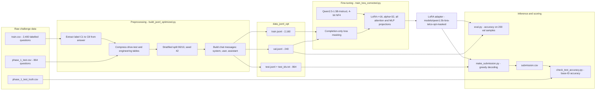
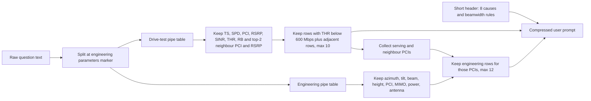
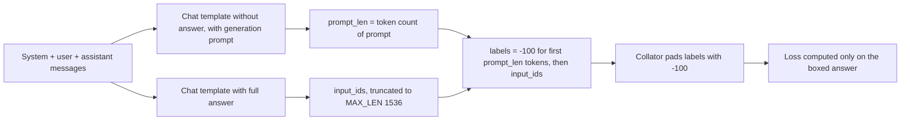

# AI Telco Troubleshooting: 5G Root-Cause Diagnosis with a Fine-Tuned Qwen2.5-1.5B

> A small language model, fine-tuned with QLoRA on a 6 GB laptop GPU, that reads 5G drive-test logs and gNodeB engineering parameters and names the root cause of a throughput drop.


**Status:** competition entry for the *AI Telco Troubleshooting Challenge* (Phase 1). The training, evaluation and submission pipeline works end to end. It is evaluated offline on the Phase 1 ground truth and is not deployed as a service.

---

## Table of contents

- [Overview](#overview)
- [Key features](#key-features)
- [Architecture](#architecture)
- [Results](#results)
- [Tech stack](#tech-stack)
- [Getting started](#getting-started)
- [Project structure](#project-structure)
- [Limitations and roadmap](#limitations-and-roadmap)

---

## Overview

When a 5G drive test shows user-plane throughput falling below **600 Mbps** on a road section, a radio engineer has to work out why. Is the downtilt too steep? Is the cell overshooting? Is a neighbour with the same PCI mod 30 causing interference? Is the vehicle simply moving too fast? Answering that means cross-reading per-second measurements (RSRP, SINR, throughput, scheduled RBs, speed, neighbour cells) against the cell configuration (azimuth, tilt, beam scenario, height, PCI).

This project turns that diagnosis into a supervised text task. Each sample bundles a drive-test table and an engineering-parameter table, and the model must pick **one of eight root causes** and answer in a strict format:

```text
\boxed{C#}
```

| Class | Root cause |
|-------|-----------|
| C1 | Serving cell downtilt too large, weak coverage at the far end |
| C2 | Serving cell coverage distance exceeds 1 km (overshooting) |
| C3 | A neighbouring cell provides higher throughput |
| C4 | Non-colocated co-frequency neighbours cause severe overlapping coverage |
| C5 | Frequent handovers degrade performance |
| C6 | Neighbour and serving cell share the same PCI mod 30, causing interference |
| C7 | Test vehicle speed exceeds 40 km/h |
| C8 | Average scheduled RBs below 160 |

Instead of a large model, the project fine-tunes **Qwen/Qwen2.5-1.5B-Instruct** with **LoRA on a 4-bit (NF4) quantized base**. Everything trains on an **RTX 4050 Laptop GPU with 6 GB of VRAM**. It is aimed at telecom and ML engineers who want a reproducible recipe for adapting a small LLM to semi-structured network data under tight hardware limits.

## Key features

- **Prompt compression for tabular telecom data.** [`build_jsonl_optimized.py`](build_jsonl_optimized.py) parses the pipe-separated tables in each question, keeps only high-signal columns, renames them (`SS-RSRP [dBm]` becomes `RSRP`), keeps the low-throughput rows plus their neighbours, and filters engineering rows down to the PCIs that actually appear. Prompts shrink from roughly 2,400 to roughly 900 tokens.
- **Completion-only loss masking.** [`train_lora_corrected.py`](train_lora_corrected.py) masks the system and user tokens with `-100`, so loss is computed only on the assistant answer `\boxed{C#}`. This stops the model from spending capacity on memorising the long prompt and lowers the risk of collapsing onto a single class.
- **QLoRA on 6 GB of VRAM.** NF4 4-bit quantization with double quantization, gradient checkpointing, a paged 8-bit AdamW optimizer and FP16, training about **18.4M of 1.56B parameters (around 1.18%)**.
- **Stratified train/validation split.** A 90/10 `StratifiedShuffleSplit` (seed 42) keeps the eight classes balanced across splits.
- **Guard rails before training.** [`preflight_check.py`](preflight_check.py) validates message roles, answer format and token length. [`cal-Truncated.py`](cal-Truncated.py) reports the share of samples that would be truncated at `MAX_LEN`.
- **Submission and scoring scripts.** [`make_submission.py`](make_submission.py) writes predictions in the challenge CSV layout. [`check_test_accuracy.py`](check_test_accuracy.py) scores them against the released Phase 1 ground truth.
- **Trained adapter included.** The LoRA adapter and tokenizer files live in [`models/qwen1.5b-lora-telco-opt-masked/`](models/qwen1.5b-lora-telco-opt-masked/), so you can run inference without retraining.

## Architecture

### End-to-end pipeline



### Prompt compression

The raw questions repeat long instructions and embed full measurement tables. The optimized builder rewrites each one into a short fixed header followed by two compact tables:



A compressed training record looks like this (shortened):

```text
[system]    You are a telecom troubleshooting assistant. From the 8 root causes C1..C8,
            output ONLY the final choice in the exact format \boxed{C#} with no extra text.
[user]      Analyze 5G drive-test + engineering parameters. ...
            Causes: C1: downtilt too large (weak far coverage) ... C8: avg scheduled RB < 160
            DriveTest:
            TS|SPD|PCI|RSRP|SINR|THR|RB|N1_PCI|N1_RSRP|N2_PCI|N2_RSRP
            2025-05-07 13:23:43.000000|12|333|-92.0|1.4|210.4|199.0|502|-89.5|151|-95.7
            ...
            Engineering:
            gNodeB ID|Cell ID|M_Azimuth|M_Downtilt|D_Tilt|D_Azimuth|BEAM|Height|PCI|MIMO|PWR|ANT
            ...
[assistant] \boxed{C4}
```

### Completion-only loss masking



### Training configuration

All values come from [`train_lora_corrected.py`](train_lora_corrected.py) and the saved [`adapter_config.json`](models/qwen1.5b-lora-telco-opt-masked/adapter_config.json).

| Group | Setting | Value |
|-------|---------|-------|
| Base model | Checkpoint | `Qwen/Qwen2.5-1.5B-Instruct` |
| Quantization | Scheme | 4-bit NF4, double quantization, FP16 compute |
| LoRA | Rank / alpha / dropout | 16 / 32 / 0.05 |
| LoRA | Target modules | `q_proj`, `k_proj`, `v_proj`, `o_proj`, `gate_proj`, `up_proj`, `down_proj` |
| LoRA | Trainable parameters | about 18.4M of 1.56B (around 1.18%) |
| Data | Max sequence length | 1,536 tokens |
| Optimisation | Batch size x grad accumulation | 4 x 8 (effective batch 32) |
| Optimisation | Learning rate | 5e-5, cosine schedule, 5% warmup |
| Optimisation | Epochs | 3 |
| Optimisation | Optimizer | `paged_adamw_8bit`, weight decay 0.01, max grad norm 0.3 |
| Precision | Mixed precision | FP16, gradient checkpointing (non-reentrant) |
| Checkpointing | Eval / save | every 100 steps, best model by `eval_loss` |

[`train_lora.py`](train_lora.py) is the earlier baseline: same LoRA setup, but no loss masking (plain causal-LM collator), learning rate 8e-5 and BF16. The masked version replaced it.

## Results

### Offline evaluation on the Phase 1 test set

Predictions in [`submission.csv`](submission.csv) were scored with [`check_test_accuracy.py`](check_test_accuracy.py) against [`data_orig/phase_1_test_truth.csv`](data_orig/phase_1_test_truth.csv). Ground-truth IDs come as `_1` to `_4` variants and are collapsed to their base ID by majority vote (in this release all four variants share the same label).

| Metric | Value |
|--------|-------|
| Scenarios evaluated (base IDs) | 864 (108 per class) |
| **Accuracy** | **53.82%** |
| Random baseline (8 balanced classes) | 12.5% |
| Classes predicted | all 8, no collapse onto a single class |

### Per-class accuracy

These figures were computed from the same `submission.csv` and truth file with the same base-ID rule.

| Class | Root cause | Accuracy |
|-------|-----------|----------|
| C1 | Downtilt too large | 9.3% |
| C2 | Overshooting, more than 1 km | 38.0% |
| C3 | Neighbour has higher throughput | 38.0% |
| C4 | Overlapping co-frequency neighbours | 33.3% |
| C5 | Frequent handovers | 98.1% |
| C6 | PCI mod 30 collision | 99.1% |
| C7 | Speed above 40 km/h | 79.6% |
| C8 | Scheduled RBs below 160 | 35.2% |

Prediction counts were C4: 149, C8: 136, C7: 135, C5: 120, C6: 107, C2: 88, C3: 82, C1: 47. The model leans towards C4, C7 and C8 and under-predicts C1.

### Error analysis

The model is close to perfect on causes that can be read straight off the tables (handovers, PCI mod 30, speed). It struggles where the diagnosis needs geometry or comparison across cells. The most frequent confusions (gold, then predicted) are:

| Gold, then predicted | Count | Telecom reading |
|---------------------|-------|-----------------|
| C1, then C8 | 32 | Weak far-end coverage also lowers the effective scheduled RBs |
| C1, then C4 | 32 | Weak serving signal looks like neighbour overlap |
| C2, then C4 | 29 | Overshooting creates overlap with distant co-frequency cells |
| C3, then C8 | 27 | Low throughput with a better neighbour versus low RB allocation |
| C8 and C4, both ways | 51 | Interference and low RB scheduling produce similar symptoms |

C1 and C2 depend on distance and downtilt geometry, which the compressed tables only show indirectly. That makes them the main target for future work.

## Tech stack

| Layer | Tools |
|-------|-------|
| Language | Python 3.10+ (the code uses `str \| None` type hints) |
| Base model | Qwen2.5-1.5B-Instruct (Hugging Face Hub) |
| Fine-tuning | Hugging Face Transformers `Trainer`, PEFT (LoRA; adapter saved with PEFT 0.18.0) |
| Quantization | bitsandbytes 4-bit NF4, paged 8-bit AdamW |
| Deep learning | PyTorch with CUDA |
| Data | pandas, Hugging Face Datasets, scikit-learn (`StratifiedShuffleSplit`), NumPy |
| Exploration | Jupyter ([`exploredata.ipynb`](exploredata.ipynb)) |
| Hardware used | NVIDIA RTX 4050 Laptop GPU, 6 GB VRAM |

## Getting started

### Prerequisites

- An **NVIDIA GPU with CUDA**. 4-bit loading through bitsandbytes and the training script both need a CUDA device. The reference run used 6 GB of VRAM.
- Python 3.10 or newer.
- Network access to download `Qwen/Qwen2.5-1.5B-Instruct` from the Hugging Face Hub on first run (about 3 GB).
- Git LFS is not required. The adapter (`adapter_model.safetensors`, about 74 MB) is stored directly in the repository.

### Installation

```bash
git clone https://github.com/yessineabdelmaksoud/ai-telco-troubeshooting.git
cd ai-telco-troubeshooting

python -m venv .venv
source .venv/bin/activate

# Install a CUDA build of PyTorch that matches your driver first (see pytorch.org), then:
pip install transformers peft bitsandbytes accelerate datasets pandas scikit-learn numpy
```

The repository does not ship a `requirements.txt`. The list above covers every import in the scripts, plus `accelerate`, which `device_map="auto"` needs.

### Configuration

The scripts have no CLI flags except the data builder. Paths and hyperparameters are constants at the top of each file, and every script expects to be **run from the repository root**:

| Script | Constants |
|--------|-----------|
| `train_lora_corrected.py` | `MODEL`, `DATA_DIR`, `OUT_DIR`, `MAX_LEN` and `TrainingArguments` |
| `eval.py` | `MODEL_BASE`, `LORA_DIR`, `VAL_PATH`, `N` (number of validation samples) |
| `make_submission.py` | `MODEL_BASE`, `LORA_DIR`, `DATA_DIR`, `OUT_CSV`, `MAX_NEW_TOKENS` |
| `check_test_accuracy.py` | `SUBMISSION_CSV`, `TRUTH_CSV` |

### 1. Build the dataset

The compressed JSONL files are already committed in `data_jsonl_opt/`. To regenerate them from the raw CSVs:

```bash
python build_jsonl_optimized.py \
  --train_csv data_orig/train.csv \
  --test_csv  data_orig/phase_1_test.csv \
  --out_dir   data_jsonl_opt
```

This writes `train.jsonl` (2,160), `val.jsonl` (240), `test.jsonl` (864) and `test_ids.txt`. Use `--val_ratio` and `--seed` to change the split. `preprocess_telco.py` takes the same arguments and produces the uncompressed variant in `data_jsonl/`.

### 2. Run the preflight checks

```bash
python preflight_check.py   # roles, \boxed{} format, token length <= 1536
python cal-Truncated.py     # % of training samples above MAX_LEN and P95 length
```

### 3. Fine-tune

```bash
python train_lora_corrected.py
```

The script prints the trainable parameter count and the share of tokens that carry loss (expected 1 to 3%), then trains for 3 epochs. The best adapter (lowest `eval_loss`) and the tokenizer are saved to `models/qwen1.5b-lora-telco-opt-masked/`. If you run out of memory, the script suggests `per_device_train_batch_size=2`, `gradient_accumulation_steps=16` or `MAX_LEN=1280`.

### 4. Evaluate on the validation split

```bash
python eval.py
```

Loads the base model in 4-bit, attaches the adapter, decodes 200 random validation samples greedily and reports format compliance and accuracy.

### 5. Generate predictions and score them

```bash
python make_submission.py       # writes submission.csv
python check_test_accuracy.py   # accuracy against data_orig/phase_1_test_truth.csv
```

### Using the adapter in your own code

This minimal example follows the same steps as `make_submission.py`:

```python
import torch
from transformers import AutoTokenizer, AutoModelForCausalLM, BitsAndBytesConfig
from peft import PeftModel

BASE = "Qwen/Qwen2.5-1.5B-Instruct"
LORA = "models/qwen1.5b-lora-telco-opt-masked"

bnb = BitsAndBytesConfig(load_in_4bit=True, bnb_4bit_quant_type="nf4",
                         bnb_4bit_use_double_quant=True,
                         bnb_4bit_compute_dtype=torch.float16)
tok = AutoTokenizer.from_pretrained(LORA)
model = PeftModel.from_pretrained(
    AutoModelForCausalLM.from_pretrained(BASE, quantization_config=bnb, device_map="auto"),
    LORA,
).eval()

messages = [
    {"role": "system", "content": "You are a telecom troubleshooting assistant. From the 8 root causes C1..C8, "
                                  "output ONLY the final choice in the exact format \\boxed{C#} with no extra text."},
    {"role": "user", "content": compressed_prompt},  # built with build_jsonl_optimized.compress_question()
]
inputs = tok(tok.apply_chat_template(messages, tokenize=False, add_generation_prompt=True),
             return_tensors="pt").to(model.device)
out = model.generate(**inputs, max_new_tokens=16, do_sample=False)
print(tok.decode(out[0][inputs["input_ids"].shape[-1]:], skip_special_tokens=True))  # e.g. \boxed{C5}
```

## Project structure

```text
ai-telco-troubeshooting/
├── data_orig/                      # Raw challenge files
│   ├── train.csv                   # 2,400 labelled questions (ID, question, answer)
│   ├── phase_1_test.csv            # 864 Phase 1 test questions
│   ├── phase_1_test_truth.csv      # Phase 1 ground truth (_1.._4 variants per ID)
│   └── SampleSubmission.csv        # Official submission layout
├── data_jsonl/                     # Uncompressed chat JSONL (preprocess_telco.py)
├── data_jsonl_opt/                 # Compressed chat JSONL used for training (build_jsonl_optimized.py)
├── models/
│   └── qwen1.5b-lora-telco-opt-masked/   # Trained LoRA adapter + tokenizer
├── build_jsonl_optimized.py        # Prompt compression + stratified split -> JSONL
├── preprocess_telco.py             # Baseline JSONL builder (no compression)
├── preflight_check.py              # Format and length checks before training
├── cal-Truncated.py                # Truncation rate at MAX_LEN
├── train_lora_corrected.py         # QLoRA training with completion-only loss masking
├── train_lora.py                   # Earlier baseline training script (no masking)
├── eval.py                         # Validation accuracy with the adapter
├── make_submission.py              # Test inference -> submission.csv
├── check_test_accuracy.py          # Scoring against Phase 1 ground truth
├── exploredata.ipynb               # Data exploration and token-length analysis
└── submission.csv                  # Predictions behind the reported 53.82%
```

## Limitations and roadmap

### Known limitations

- **Accuracy ceiling.** 53.82% is more than four times the random baseline, but C1 (9.3%) and C2, C3, C4 and C8 (33 to 38%) are still weak. The model is a decision-support aid, not an autonomous diagnostician.
- **Offline evaluation only.** Scores come from the public Phase 1 ground truth, not from a hidden leaderboard set.
- **Submission ID format.** `make_submission.py` writes one row per base ID (`ID_XXXX`), while `SampleSubmission.csv` expects suffixed IDs (`ID_XXXX_1` to `_4`) covering Phase 1 and Phase 2. Rows would need to be expanded before an official upload.
- **Single hard-coded fallback.** If no label is found in a generation, `make_submission.py` falls back to `C3`.
- **Information loss from compression.** Prompts keep at most 10 drive-test rows and 12 engineering rows. Longitude and latitude are dropped, which removes direct distance cues that C1 and C2 depend on.
- **Reproducibility.** There is no pinned `requirements.txt`, `eval.py` samples validation rows without a fixed seed, and no LICENSE file is included yet.

### Roadmap

- [ ] Rule-based post-processing for threshold-defined causes (for example RB below 160 for C8, speed above 40 km/h for C7)
- [ ] Self-consistency: sample several generations and take a majority vote
- [ ] Add derived geometry features (cell-to-UE distance, tilt versus beamwidth) to help C1 and C2
- [ ] Short natural-language justification before `\boxed{C#}` for explainability
- [ ] Oversample hard classes (C1, C2), try a slightly higher learning rate (6e-5 to 7e-5), add one extra epoch on misclassified samples
- [ ] Pin dependencies, add a `requirements.txt`, expand submission rows to the `_1.._4` ID format and add a license

---

Built by [Yessine Abdelmaksoud](https://github.com/yessineabdelmaksoud) · [Portfolio](https://yessineabdelmaksoud.github.io)
